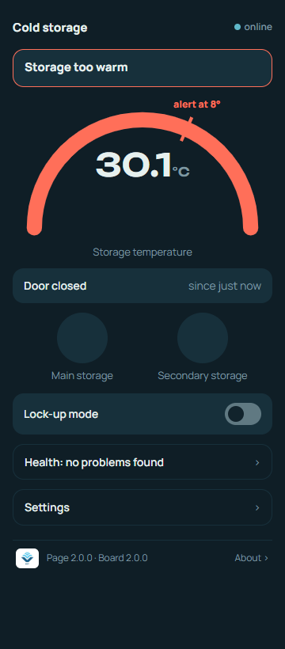
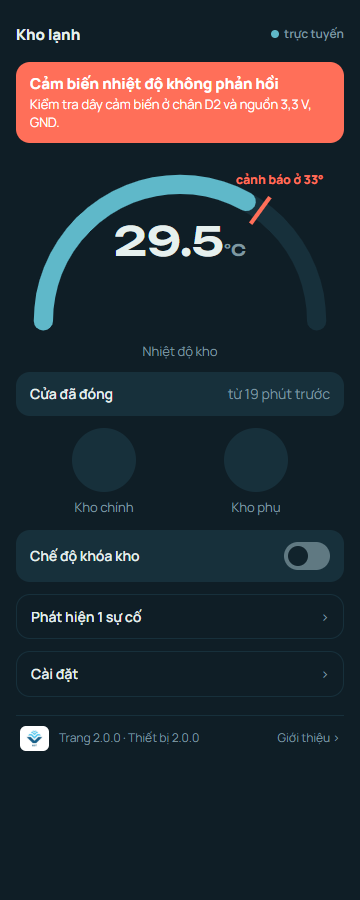
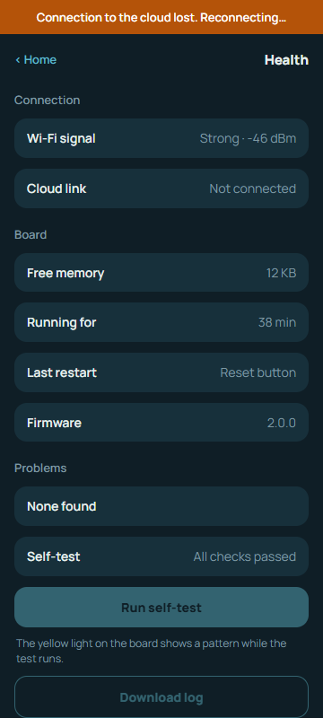
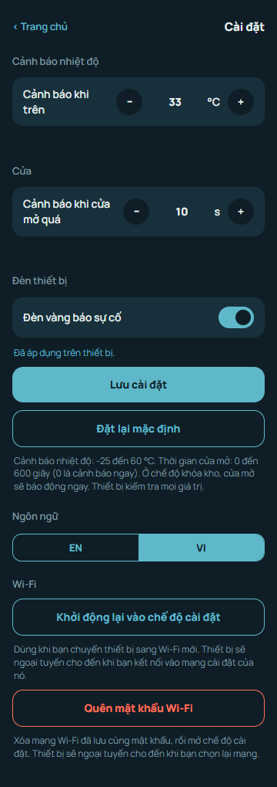

# Cold Storage Monitor: an ESP8266 IoT node with a cloud dashboard

| | |
|---|---|
| **Project** | Remote monitoring and control of a cold storage room |
| **Student / ID / class** | *(add before sharing)* |
| **Supervisor** | *(add before sharing)* |
| **School year** | 2026–2027 |
| **Code** | https://github.com/datnguyenstu-lab/smarthome |
| **Live app** | https://datnguyenstu-lab.github.io/smarthome/ (login needed; ask the student for a demo account) |
| **Report date** | 2026-11-15 |

---

## Tóm tắt (Vietnamese summary)

Đề tài xây dựng hệ thống **giám sát kho lạnh từ xa** dùng vi điều khiển **ESP8266 (NodeMCU)**. Thiết bị đo **nhiệt độ** bằng cảm biến DS18B20, phát hiện **cửa mở/đóng** bằng cảm biến hồng ngoại, điều khiển **hai đèn kho** ("Kho chính", "Kho phụ") và có một **đèn vàng báo trạng thái**. Dữ liệu được gửi qua **MQTT có mã hóa TLS** lên **EMQX Cloud**, và người dùng xem/điều khiển bằng **trang web** (GitHub Pages) từ bất kỳ điện thoại nào, hỗ trợ **tiếng Việt và tiếng Anh**.

Hệ thống cảnh báo khi **cửa mở quá lâu**, **nhiệt độ quá cao**, **cửa bị mở khi đã khóa kho** và khi **cảm biến lỗi**. Ngoài ra có: tự kiểm tra thiết bị, cài đặt ngưỡng ngay trên trang web, cập nhật firmware qua Wi-Fi (OTA), nhật ký sự kiện lưu trong thiết bị (tải về từ trang web), hướng dẫn kết nối lại Wi-Fi, và cảnh báo qua Telegram (phần thiết bị đã xong, đang cấu hình phía EMQX). Toàn bộ logic quan trọng được kiểm thử tự động (**182 bài kiểm thử**) và đã được kiểm tra trên phần cứng thật.

---

## 1. Summary

The system watches one cold storage room. A NodeMCU ESP8266 board reads the room temperature and the state of the door, publishes them to a cloud MQTT broker over TLS, and accepts commands back. Two people can open a web page on any phone, from anywhere, to see the room, switch the two storage lights, and read alerts.

What a user gets:

- **Live dashboard:** temperature on a dial with the alert mark, door state ("Door closed / open, since…"), two light switches, Lock-up mode.
- **Alerts:** door open too long, storage too warm, door opened while locked up, temperature sensor fault.
- **Health and self-test:** signal, memory, uptime, last restart, problems found, and a self-test that can be started from the page.
- **Settings on the page**, saved on the board: temperature threshold, door-open time, status-light on/off.
- **Event log kept on the board**, downloadable from the page as a compressed file.
- **Reconnect guide** and a "Forget Wi-Fi password" button for moving the board to a new network.
- **Over-the-air firmware update** from a computer on the same network, with the firmware version shown in the page.
- **English and Vietnamese** interface (switch on the login screen and in Settings; follows the browser language).
- **Telegram alerts:** the board side is done and tested; the EMQX side is being configured (see §10).

## 2. Goals and scope

**Goals**

1. Measure the storage temperature and detect an open door, reliably and continuously.
2. Make the data and the controls reachable from anywhere, not only on the home network.
3. Tell the person what is wrong and how to fix it, without a serial cable.
4. Keep the project reproducible: tested logic, documented setup, encrypted private files.

**Out of scope for this phase:** a humidity sensor, battery or sleep mode, several boards, push notifications other than Telegram.

The project started as a small "smart home" node (lights, presence, temperature) and was re-purposed during development to the cold-storage use case; the design documents in `docs/superpowers/` record both stages.

## 3. System overview

```
  Sensors / LEDs / buttons
          |
   +--------------+     TLS MQTT (8883)      +------------------+     WSS MQTT (8084)     +------------------+
   |  NodeMCU     | <----------------------> |  EMQX Cloud      | <---------------------> |  Web page        |
   |  ESP8266     |  publish state, receive  |  Serverless      |  subscribe, send        |  (GitHub Pages)  |
   |  firmware    |  commands, last will     |  broker          |  commands               |  EN / VI         |
   +--------------+                          +------------------+                         +------------------+
          ^                                          |
          | Wi-Fi OTA (same network)                 +--> rule: alert event --> Telegram bot (in progress)
       Computer
```

- **Broker:** EMQX Cloud Serverless (free tier). The board and the web page are both clients of the broker; they never talk to each other directly, which is what makes it work from any network.
- **State is retained:** every value the page shows (temperature, door, alert, settings, health) is a *retained* MQTT message, so a page that opens later sees the latest value at once. The board's *last will* sets `status = offline` if it drops.
- **Web page:** static files, no server of its own. It logs in with the user's broker credentials, kept in memory only.

Main topics (prefix `smarthome/`):

| Topic | From | Meaning |
|---|---|---|
| `status` | board | `online`, or `offline` (last will) |
| `temp`, `door`, `door_changed`, `alert` | board | live values (retained) |
| `health`, `selftest`, `settings`, `info` | board | JSON, retained (health every 10 s) |
| `state/led2`, `state/led3`, `state/away` | board | light and Lock-up states |
| `cmd/led2`, `cmd/led3`, `cmd/away`, `cmd/settings`, `cmd/selftest`, `cmd/setup`, `cmd/forgetwifi`, `cmd/log` | page | commands |
| `event/alert` | board | one message per real alert change, with a bilingual sentence |
| `log/index`, `log/data` | board | event-log download in chunks |

## 4. Hardware

| Part | Pin | Notes |
|---|---|---|
| NodeMCU ESP8266 (ESP8266MOD), 4 MB flash | USB | 2.4 GHz Wi-Fi only |
| IR obstacle sensor, used as the **door sensor** | D0 | sees the closed door = closed; sees nothing = open |
| DS18B20 temperature sensor (module with pull-up) | D2 | 3.3 V, data, GND |
| Button 1 | D1 | toggles "Main storage"; hold 5 s = setup mode |
| Button 2 | D4 | toggles "Secondary storage" (must not be held low at boot) |
| LED 1, yellow | D7 | the **status light** (patterns below), not a light to control |
| LED 2 (middle) / LED 3 (right) | D6 / D5 | "Main storage" / "Secondary storage" lights |

*(Add a photo of the breadboard here.)*

## 5. Firmware

Written in C++ (Arduino framework, PlatformIO). The decision logic is kept **pure** (no hardware calls) in `lib/logic/` so it can be tested on a PC; `src/` connects that logic to the board.

| Module | Job |
|---|---|
| `alerts` | Chooses the single current alert and applies hysteresis |
| `settings` | Parses, clamps and formats the settings JSON; stored in flash (LittleFS) |
| `health`, `health_monitor` | Six problem rules (below), health message, self-test |
| `statusled` | Picks the yellow-LED pattern |
| `logfmt`, `event_log` | Log line format, rotation, chunked download |
| `alertmsg` | Builds the bilingual alert event |
| `net`, `wifi_setup` | TLS MQTT, NTP time, OTA, Wi-Fi setup portal |
| `timing` | Debounce, long press, sensor-fault filter |

**Alerts** (one at a time, highest priority first)

| Alert | Raised when | Default |
|---|---|---|
| Door opened while locked up | the door opens while Lock-up mode is on | at once |
| Door open too long | the door stays open longer than the grace time | 10 s (0–600 s) |
| Temperature sensor not responding | three bad readings in a row (about 30 s) | |
| Storage too warm | temperature at or above the threshold; clears 1 °C below | 33 °C (−25 to 60 °C) |

**Health problems** the board watches continuously: sensor fault, door open for 30 minutes, weak Wi-Fi (below −80 dBm), unstable connection (more than 3 drops in 10 minutes), low memory (below 10 KB), restart after a crash.

**Yellow status light**

| Pattern | Meaning |
|---|---|
| fast blink | setup mode |
| long, short, short | self-test running (at start-up and on command) |
| double blink | no Wi-Fi |
| slow blink | Wi-Fi up, cloud not reachable |
| triple blink | a problem was found |
| dark | all is well |

**Other behaviour**

- **Setup mode:** hold button 1 for 5 s, or use the page. The board opens the `SmartHome-Setup` network (password protected); the person picks the new Wi-Fi in a captive portal. "Forget Wi-Fi password" erases the saved network first and does not fall back to the compiled-in default.
- **Event log:** one line per event, `time level component message`, in rotating 64 KB files (newest 3 kept). A half-written last line after a power cut is repaired at boot. Example: `2026-11-14T17:19:13Z INFO  selftest passed temp=ok door=ok wifi=ok cloud=ok`.
- **Temperature read:** started and collected without blocking the loop, so the buttons stay responsive.
- **OTA:** password-protected update over the local network; a wrong password is refused.

## 6. Web application

Plain HTML, CSS and JavaScript, no build step, hosted on GitHub Pages. The MQTT.js library runs in the browser over WebSocket TLS.

- **Screens:** Home (dial, door, lights, Lock-up), Health, Settings, About, and the reconnect guide.
- **Design:** one dial-based layout chosen from three mock-ups; dark and light themes follow the device.
- **Languages:** English and Vietnamese. Every visible text goes through one translation table; an automated test fails if any text has no Vietnamese version.
- **Connection awareness:** the login screen says whether the problem is a wrong password, no internet, or an unreachable cloud; after login an amber bar appears on every screen while the cloud link is down.
- **Door row:** it turns red only when the board raises the alert, so the grace time is respected.
- **Log download:** the page asks the board for its log files over MQTT, reassembles the chunks (tolerating lost or duplicate ones) and saves one compressed file with a short header.

| Home (English, dark) | Home (Vietnamese, with a sensor-fault alert) |
|---|---|
|  |  |
| **Health (English), cloud link lost: amber bar on every screen** | **Settings (Vietnamese)** |
|  |  |

*Screenshots were taken from the live app connected to the real board.*

## 7. Cloud and security

- **Transport:** the board verifies the broker's certificate (CA included in the firmware) and needs correct time, so it syncs the clock over NTP before connecting.
- **Accounts:** the board and each person have their own broker login. The page never stores a password.
- **Access rules:** the board may publish everything except commands and subscribe to commands; people may subscribe to everything and publish only commands. *Status: the rules are entered in EMQX but the deployment is still in its default "allow unmatched" mode (see limitations).*
- **Secrets kept out of the public repository:** passwords live in a git-ignored file; the repository holds them only as an **AES-256-GCM encrypted vault** (key from PBKDF2, 600,000 rounds). The student's personal details are not in the page source: they are delivered after login as a retained broker message. Every push is preceded by a scan of the whole history for secrets.
- **Device protection:** OTA and the setup network each have a password; commands that could disrupt the board are ignored for 3 s after reconnecting so a stored command cannot cause a reboot loop.

## 8. Testing and verification

**Automated (182 tests, all passing)**

| Suite | Tests | Covers |
|---|---|---|
| Firmware logic, run on the PC (Unity) | 107 | alerts and priority, settings clamp/parse, health rules, LED patterns, log format and rotation, debounce, sensor-fault filter, alert messages |
| Web logic (Node test runner) | 68 | page helpers, translations (coverage test), log reassembly, connection errors |
| Vault (Python) | 7 | round trip, wrong passphrase, tampering, file swapping |

A headless browser was also used to check the real page against the real board: login, wrong password, no network, cut connection and reconnect, settings validation, lamp control, log download, language switch, and a scan of every screen for untranslated text.

**Verified on the hardware:** both sensors, both buttons and all LEDs; Wi-Fi setup portal; cloud connection and last will; settings saved and kept across a reboot; self-test and its LED pattern; OTA update with a wrong and a correct password; event log rotation and recovery after six forced resets during writing; firmware version change from `2.0.0` to `2.1.0-demo` and back.

**Measurements**

| Item | Result |
|---|---|
| Firmware size | 52% of flash, 43% of RAM |
| Free memory while connected | about 12–13 KB (warning level 10 KB) |
| Temperature and health updates | every 10 s |
| Board marked offline after "setup mode" | 0.2 s (it was 45–60 s before the fix) |
| OTA update time | about 35–40 s |
| Downloaded log, compressed in the browser | 34,902 bytes to 1,126 bytes |

## 9. Problems found and how they were solved

| Problem | Cause | Fix |
|---|---|---|
| Board not seen by the PC | USB driver missing | installed the CP210x driver |
| Boot loop after wiring a button | D4 (GPIO2) must be high at boot | re-wired the button so it is not pressed at boot |
| Board could not join Wi-Fi | 5 GHz hotspot and a wrong network name | the ESP8266 is 2.4 GHz only |
| TLS connection hung | certificate check needs the real time | NTP sync with a timeout and restart |
| Temperature read `-127` | loose or wrong sensor wiring | added a wiring diagnostic; confirmed the sensor was fine |
| Alarm flipped on one bad reading | no filtering | fault only after 3 bad reads in a row; tests replay the real pattern |
| Page said "online" for a minute after "forget Wi-Fi" | the broker waits for the keep-alive to expire | the board publishes `offline` and disconnects first |
| Setup portal closed instantly when started from a command | the loop exited because Wi-Fi was already connected | the loop now waits for the portal itself |
| Door row red before the grace time | the page coloured it on "open", not on the alert | the row follows the board's alert |
| "Board stopped reporting" on a phone with a wrong clock | page compared the board's clock with the phone's | the page times the arrival of live messages instead |
| Personal details in a public repository | static page source is public | details sent after login as a retained broker message |

## 10. Limitations and future work

- **Telegram alerts:** the board already publishes one bilingual event per real alert change (tested live). Still to do: create the bot and the EMQX rule (steps in `docs/telegram-alerts.md`).
- **Access rules not enforced yet:** switching the EMQX deployment to whitelist mode and testing that a person login cannot publish sensor data.
- **Demo-level credentials:** the test accounts and the vault passphrase are simple on purpose; they should be replaced before any real use.
- **Door sensor health:** an unplugged IR sensor looks like a door state; it cannot be reported as a fault.
- **Cloud outage:** while the cloud is unreachable, each reconnect attempt briefly blocks the loop, so buttons feel slow.
- **Ideas:** humidity sensor, history chart, battery operation, several boards.

## 11. How to run it

1. Install PlatformIO and Python; copy `include/secrets.example.h` to `include/secrets.h` and fill it in (or restore it with `python tools/vault.py unlock`).
2. Flash: `pio run -e nodemcuv2 -t upload`. Later updates: `pio run -e ota -t upload` (needs the OTA password).
3. Run the tests: `pio test -e native`, `node --test "web/test/*.test.mjs"`, `python -m unittest discover -s tools -p "test_*.py"`.
4. Publish the page: `git subtree push --prefix web origin gh-pages`.

The README holds the full instructions, the wiring, the topic list and the tools.

**Five-minute demo**

1. Open the live app, log in, switch EN/VI.
2. Switch a storage light on the page, then press the matching button on the board: both stay in sync.
3. Cover the door sensor (closed), then uncover it: the row shows "open, warns after 10 s", then the red alert.
4. Turn Lock-up mode on and open the door: the alarm is immediate.
5. Health screen: run the self-test (watch the yellow light), download the log.
6. Run `tools/demo_ota.ps1` to change the firmware version over Wi-Fi and see it in Health and About.
7. Unplug the board: the connection bar and the reconnect guide appear.

## 12. Repository map

| Path | Content |
|---|---|
| `src/` | firmware (board-specific code) |
| `lib/logic/` | pure logic, tested on the PC |
| `web/` | the web application and its tests (`web/test/`) |
| `test/test_native/` | firmware logic tests |
| `tools/` | watch/publish/pull-log tools, vault, demo-OTA scripts, vault tests |
| `docs/superpowers/` | design documents and the implementation plans |
| `docs/telegram-alerts.md` | Telegram setup guide |
| `private/` | encrypted private files (vault) |

## 13. Development process

The work followed a written design, then an implementation plan, then test-first implementation (the failing test first, then the code), with a self-review of the whole branch at the end. The design and plans are in `docs/superpowers/`. The student defined the requirements and the final behaviour, built and wired the hardware, and tested on it; parts of the code and the documentation were produced with an AI coding assistant (Claude Code) working under the student's direction.
